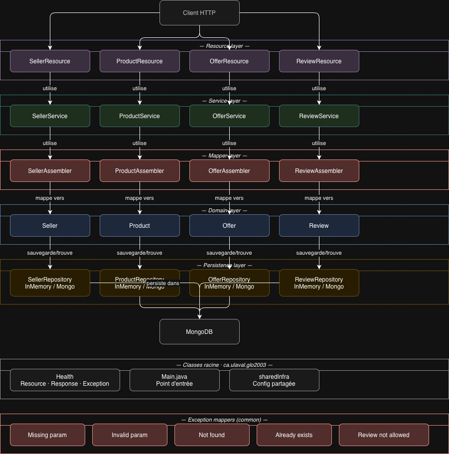

# Floppa 🛒

API REST de marketplace entre particuliers : les vendeurs publient des produits, les acheteurs font des offres, le vendeur choisit une offre pour conclure la vente, puis l'acheteur peut laisser un avis.

Projet d'équipe réalisé en 4 itérations (TP1 → TP4) avec un vrai processus de développement : issues, milestones, pull requests avec revue de code et pipeline CI/CD.

## Technologies

| Domaine | Outils |
|---|---|
| Langage / build | Java 21, Maven |
| API REST | Jersey (JAX-RS), serveur Grizzly, HK2 (injection de dépendances), JSON-B |
| Persistance | MongoDB, Morphia (ODM), mode InMemory |
| Tests | JUnit 5, Mockito, AssertJ, Hamcrest, RestAssured, Jersey Test Framework, Testcontainers |
| Qualité | Spotless (google-java-format), JaCoCo (couverture), Codacy |
| Sécurité / monitoring | Snyk, Sentry |
| DevOps | Docker, Docker Compose, GitHub Actions, GHCR |
| Gestion de projet | GitHub Projects, Issues, Milestones, Pull Requests |

## Fonctionnalités

| Méthode | Route | Description |
|---|---|---|
| POST | `/sellers` | Créer un vendeur |
| GET | `/sellers/{sellerId}` | Consulter un vendeur et ses produits |
| POST | `/products` | Publier un produit |
| GET | `/products` | Filtrer les produits |
| GET | `/products/{productId}` | Consulter un produit et les statistiques de ses offres |
| POST | `/products/{productId}/offers` | Faire une offre |
| POST | `/products/{productId}/sell` | Vendre un produit à une offre choisie |
| POST | `/sellers/{sellerId}/reviews` | Laisser un avis sur un vendeur (acheteurs seulement) |
| POST | `/buyers/{username}/favorites` | Ajouter un produit aux favoris |

**Règles métier notables** : statut de vente (`ongoing` / `sold`), offre sélectionnée, statistiques d'offres (nombre, moyenne, min, max), avis réservé aux acheteurs ayant réellement acheté chez le vendeur (min. 50 caractères).

## Architecture

Architecture en couches par domaine (`seller`, `product`, `offer`, `review`, `buyer`) :
`resource` (API) → `service` (logique métier) → `domain` (entités + interfaces de repository) → `persistence` (InMemory / Mongo).

La persistance se choisit au lancement : `-Dpersistence=inmemory` (défaut) ou `-Dpersistence=mongo`.

## Mes tâches

- Implémentations des fonctionnalités liées aux produits
- Écriture de tests unitaires (Mockito) et d'intégrations des classes liées à Product.
- Configuration du pipeline CI/CD : build, tests, Spotless, publication de l'image Docker sur GHCR, Codacy et Snyk.
- Rédaction des user stories, issues et revues de pull requests.

## Ce que j'ai appris

- Structurer une API selon une **architecture en couches** et appliquer l'**inversion de dépendances** (le domaine définit les interfaces, la persistance les implémente).
- Écrire des **tests abstraits** réutilisés pour valider plusieurs implémentations d'une même interface.
- Tester contre une vraie base MongoDB jetable grâce à **Testcontainers**.
- Mettre en place un **pipeline CI/CD** complet et comprendre sa valeur pour détecter les régressions tôt.
- Intégrer la sécurité et le monitoring en continu (**Snyk**, **Sentry**, **Codacy**).
- Travailler en équipe avec Git : branches par fonctionnalité, convention de commits, PR courtes et revues de code.
- Gérer les incompatibilités de versions (Java 21 avec certains outils) en procédant par étapes.

## Code source

Le code source est hébergé dans un dépôt privé (projet universitaire, Université Laval).
